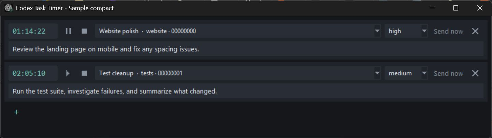
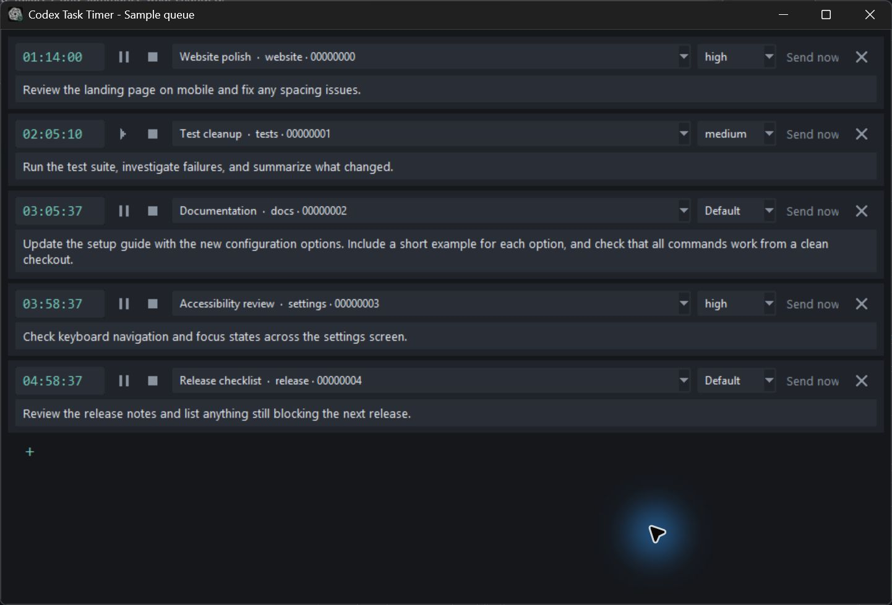

# Codex Task Timer

A small, dark Windows app that queues messages for your existing Codex CLI chats and sends them when a countdown ends.



## Features

- Multiple independent tasks, each with a chat, thinking level, message, and live countdown.
- Chats from every working directory; new tasks select the most recently updated chat and its folder automatically. Choose **New chat** at the bottom of the dropdown to start a fresh conversation in that folder (right-click to change it).
- New timers default to your five-hour usage reset **plus one minute**, when available.
- Pause, resume, stop, send immediately, or remove a task.
- Messages wrap and grow to fit. Successful tasks disappear after Codex finishes.
- Open chats use the existing Codex server when available. Busy chats wait without interrupting their current turn.
- Tasks survive restarts; acknowledged shared-server runs reconnect without resending.



Screenshots show the actual app with isolated sample data; the screenshot demo never sends messages.

## Get started

Requires **Windows**, an installed **Codex CLI**, and an existing Codex sign-in and chat history.

Download the Windows ZIP from [Releases](https://github.com/thencious/codex-task-timer/releases), extract it to a writable folder, and open `CodexTaskTimer.exe`. Optionally run `install-shortcuts.ps1` to add desktop and Start menu shortcuts.

Or run from source with **Python 3.10+ and Tkinter**; no third-party runtime packages are needed:

```powershell
git clone https://github.com/thencious/codex-task-timer.git
cd codex-task-timer
python app.py
```

## Use it

1. Choose a chat and thinking level, then enter the message.
2. Enter a delay such as `0:05` or `2:30`. **Enter** or clicking away starts it immediately. The display includes seconds; input uses hours and minutes.
3. Click **+** to add another task. Keep the app running for delivery.

You can also enter whole hours (`3`), decimal hours (`3.5`), or compact hours/minutes (`330`). **Esc** or clearing the timer cancels it; an explicit `0:00` sends immediately. **Send now** bypasses the countdown.

The pause icon freezes the countdown; the square stops and clears it. The **×** at the far right removes the task. **Enter** in a message finishes editing and focuses **+**; Enter again adds a task. Pasted multiline text is preserved. Right-click a task to override its working folder or view an error.

An automatic reset timer with an empty chat or message deletes its task on expiry without sending. A manually entered timer with missing fields waits at zero. Failed tasks remain available for inspection and retry.

## Delivery and local data

Timers use real wall-clock deadlines. A sleeping PC sends overdue tasks after waking; a closed app sends them after reopening. Tasks for the same chat run in deadline order; different chats can run independently. A chat held by a separate Codex instance may need that instance to release it before delivery can proceed.

Tasks, messages, and run logs stay in `data/` beside the app. This directory is excluded from Git. A single-instance lock prevents duplicate queues. If a connection fails after submission, check the chat before retrying: delivery may already have occurred.

Unattended runs disable interactive approval prompts and retain Codex's configured sandbox. Operations that require approval can fail. Chat discovery and shared-server delivery depend on Codex's local storage and app-server interfaces; compatibility may change with CLI updates. This is an independent tool, not an official OpenAI app.

## Develop and build

```powershell
python -m unittest discover -s tests
python -m venv .build-venv
.\.build-venv\Scripts\python.exe -m pip install PyInstaller==6.22.3
powershell -NoProfile -ExecutionPolicy Bypass -File build-app.ps1
powershell -NoProfile -ExecutionPolicy Bypass -File install-shortcuts.ps1
```

Close the timer before rebuilding its executable. The executable embeds its own icon and uses a separate Windows app identity. `python tools/screenshot-demo.py` opens the isolated five-task screenshot demo; add `--compact` for two tasks.

Codex references: [non-interactive mode](https://learn.chatgpt.com/docs/non-interactive-mode), [CLI commands](https://learn.chatgpt.com/docs/developer-commands?surface=cli), and [app-server](https://learn.chatgpt.com/docs/app-server).
